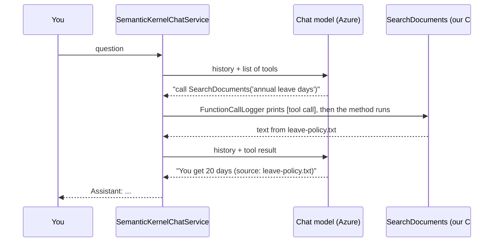

# Code explained

A walk through the code in the order it runs. Everything is in `AIKnowledgeAssistant.SemanticKernel/`.

## 1. The big picture

The app is a chat in the console. You type a question and the model answers.
The model can also use **tools**. A tool is a normal C# method that we allow the model to ask for.

Remember one rule: **the model never runs our code.** It only says "please call `ListTasks`".
Semantic Kernel (SK) then runs the method and gives the result back to the model.

| Two kinds of tools | What they do |
| --- | --- |
| Task tools | `ListTasks`, `CreateTask`, `CompleteTask` work on a fake in-memory list |
| Document tool | `SearchDocuments` finds text in the `.txt` files (this is **RAG**) |

## 2. What happens when the app starts

`Program.cs` runs these steps:

1. **Read settings** from `appsettings.json` (endpoint, key, model names) into `AiSettings`.
2. **Create `SemanticKernelChatService`**. It builds the kernel and registers the tools.
3. **Index the documents**. Each file is cut into chunks, and each chunk is turned into a vector (a list of numbers that stands for its meaning). The vectors are kept in memory.
4. **Start the chat loop**. Read a question, call `SendUserMessageAsync`, print the answer.

## 3. What happens when you ask a question

Example: *"How many annual leave days do I get?"*



All of this happens inside one line of our code:

```csharp
await _chatCompletion.GetChatMessageContentAsync(_chatHistory, _executionSettings, _kernel, ...);
```

`FunctionChoiceBehavior.Auto()` tells SK to run this loop by itself.
There is no "are you sure?" question, so a tool runs as soon as the model asks for it.

## 4. File by file

### `Program.cs`
Entry point. It holds the **system prompt**, the rules we give the model before the user says anything.
The key rule: for policy questions, call `SearchDocuments` first and answer only from the result.

### `Services/SemanticKernelChatService.cs`
All the Semantic Kernel setup:

| Step | Code | Why |
| --- | --- | --- |
| 1 | `AddAzureOpenAIChatCompletion` | the model that chats and decides which tool to use |
| 2 | `AddAzureOpenAIEmbeddingGenerator` | the model that turns text into vectors, used by RAG |
| 3 | `AddSingleton<IFunctionInvocationFilter, FunctionCallLogger>` | prints every tool call |
| 4 | `Plugins.AddFromObject(TaskManagementPlugin)` | registers the task tools |
| 5 | `Plugins.AddFromObject(DocumentPlugin)` | registers the search tool (added after `Build()` because it needs the embedding service) |

It also keeps the `ChatHistory`. The model has no memory, so we send the whole conversation every time.

### `Plugins/TaskManagementPlugin.cs`
A plugin is a normal class. Two attributes make a method a tool:
- `[KernelFunction("ListTasks")]` means "this method is a tool".
- `[Description("...")]` is the text the model reads to know when to use it.

SK builds the tool description for the model from these attributes. Nothing is written by hand.

### `Plugins/DocumentPlugin.cs`
One tool, `SearchDocuments(query)`. It just calls `DocumentSearchService`.
This shows that RAG is not special: to the model it is one more tool.

### `Services/FunctionCallLogger.cs`
A **filter** is code SK runs around every tool call. It prints:
- `[tool call] Plugin.Function(arguments)` before the method runs
- `[tool result] ...` after it runs

It only logs. It never blocks or asks anything.

### `Data/InMemoryTaskStore.cs` and `Models/`
The fake database: a list with 3 starting tasks. It resets when the app restarts.
The methods return plain text, which is what the model reads.

### `Configuration/AiSettings.cs` and `Services/AzureEndpointHelper.cs`
`AiSettings` holds the values from `appsettings.json`.
`AzureEndpointHelper` keeps only the base address (`https://name.openai.azure.com/`), because that is what SK expects.

## 5. The RAG files (`Rag/`)

RAG = **R**etrieval **A**ugmented **G**eneration. First *retrieve* the right text, then let the model *generate* the answer from it.
This stops the model from guessing.

| Step | File | What it does |
| --- | --- | --- |
| 1. Chunk | `TextChunker.cs` | splits a file on blank lines, and joins small paragraphs up to about 500 characters |
| 2. Embed | `DocumentSearchService.cs` | sends each chunk to the embedding model and gets a vector (1536 numbers) |
| 3. Store | `InMemoryVectorStore.cs` | keeps `(chunk, vector)` pairs in a list. No database |
| 4. Search | `InMemoryVectorStore.Search` | embeds the question, compares it with every vector, and keeps the top 3 above 0.3 |
| 5. Answer | tool result | the matching text, with source file and score, goes back to the model |

**Cosine similarity** measures if two vectors point the same way. Near 1 means the same meaning. Near 0 means unrelated.

If nothing is similar enough, the tool returns `NOT_FOUND`. The system prompt says to answer "not found" in that case, so the model does not invent an answer.

## 6. Things to say in the presentation

- A tool is just a C# method with `[KernelFunction]` and `[Description]`.
- The model asks. Our code runs. The result goes back to the model.
- `FunctionChoiceBehavior.Auto()` is what turns the loop on.
- RAG is a tool too: search first, then answer from the result.
- Embeddings turn meaning into numbers, so a question can match text that uses different words.
- The `[tool call]` lines in the console prove that the model chose the tool.

## 7. Try it

| Ask | Expect |
| --- | --- |
| `List tasks` | `[tool call] TaskManagement.ListTasks()`, then the 3 tasks |
| `Create task Review PR` | `CreateTask(title=Review PR)` runs at once, with no confirmation |
| `How many annual leave days do I get?` | `Documents.SearchDocuments(...)`, then "20 days", source `leave-policy.txt` |
| `What is the CEO's favourite colour?` | `NOT_FOUND`, and the model says it is not in the documents |
