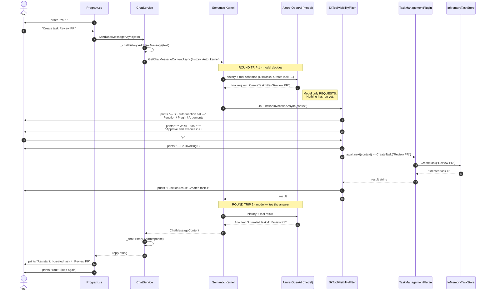
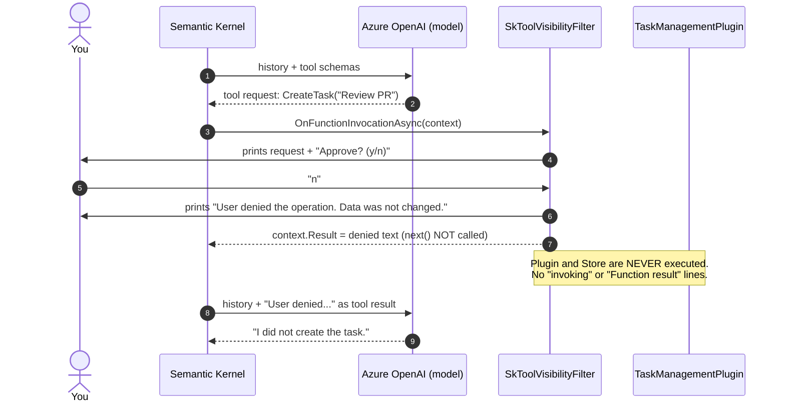
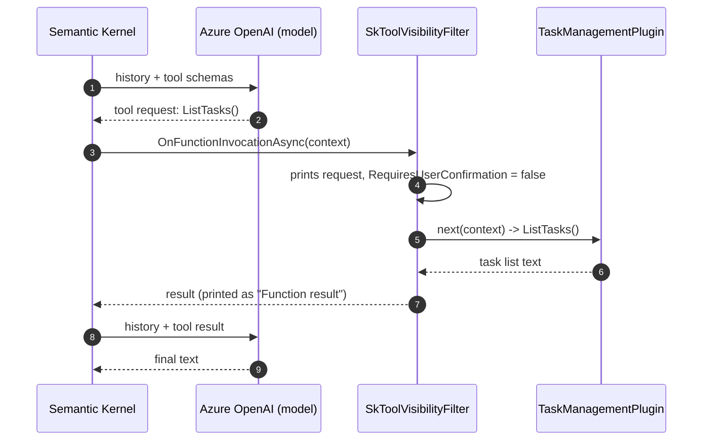
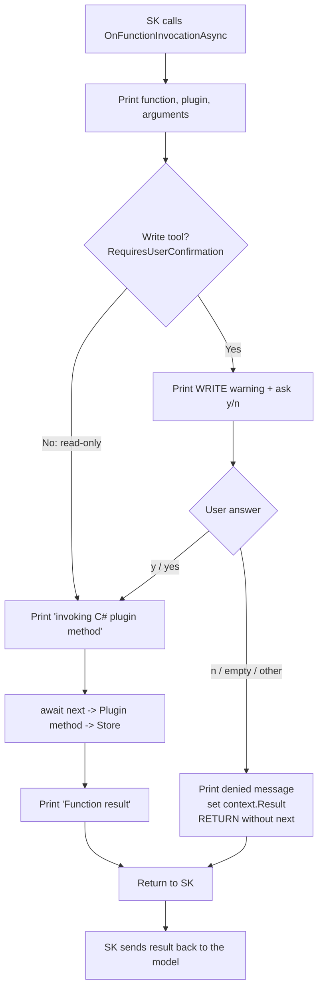

# Execution Flow — Semantic Kernel Project

Who calls what, and who prints each console line, for the user input **`Create task Review PR`**.

**Golden rule:** the model never runs C#. It only *requests* a function. Semantic Kernel (SK) and our code execute it.

---

## 1. Participants

| Participant | File | Role |
| --- | --- | --- |
| **You** | console | Types questions, answers y/n |
| **Program.cs** | `Program.cs` | Reads input, prints `You:` / `Assistant:` / `Error:` |
| **ChatService** | `Services/SemanticKernelChatService.cs` | Holds Kernel + ChatHistory, calls SK once per question |
| **SK** | Semantic Kernel library | Runs the tool-calling loop (`FunctionChoiceBehavior.Auto`) |
| **Azure OpenAI** | cloud | The model: returns a tool request or final text |
| **Filter** | `Services/SkToolVisibilityFilter.cs` | Called **by SK** before every tool: logs + asks y/n for writes |
| **Plugin** | `Plugins/TaskManagementPlugin.cs` | The real C# tool methods |
| **Store** | `Core/Data/InMemoryTaskStore.cs` | The in-memory task list |

---

## 2. Full sequence — write tool, user approves

---

## 3. User denies the write (types `n`)

---

## 4. Read-only tool (`List tasks`)

Same as section 2, **minus** the WRITE warning, the y/n prompt and the user's answer:

---

## 5. Decision flow inside the filter

---

## 6. Who prints each console line

| Console output | Printed by | Condition |
| --- | --- | --- |
| Startup banner (`AI Tool-Using Knowledge Assistant`, deployment, URL...) | `Program.cs` | once at startup |
| `You:` | `Program.cs` | every loop |
| `--- SK auto function call ---`, `Function:`, `Plugin:`, `Arguments:` | **Filter** (called by SK) | every tool call |
| `*** WRITE tool ***`, `Approve and execute in C#? (y/n)` | **Filter** | write tools only |
| `User denied the operation...` | **Filter** | answer was not y/yes |
| `--- SK invoking C# plugin method now ---` | **Filter** | read tools, or approved writes |
| `Function result: ...` | **Filter** | after the plugin ran |
| `Assistant: ...` | `Program.cs` | after all tool calls finish |
| `Error: ...` | `Program.cs` | an exception was thrown |
| `Goodbye.` | `Program.cs` | after `exit` |

---

## 7. Key takeaways

- **One line in our code, many steps inside SK.** `GetChatMessageContentAsync` hides the loop we wrote by hand in the Manual project.
- **At least 2 model calls per tool use:** (1) get the tool request, (2) get the final answer. Our C# runs only between them.
- **The filter is called by SK, never by us**, once per tool call. No tool request means no filter call.
- **Confirmation is the application's job, not the model's.** The filter can block execution by not calling `next()`.
- **Kubernetes analogy:** the model is the controller that emits "run job CreateTask". SK is the operator, the filter is the admission webhook (approve/deny), and the plugin is the job that touches the real system.
