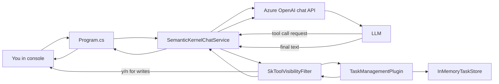
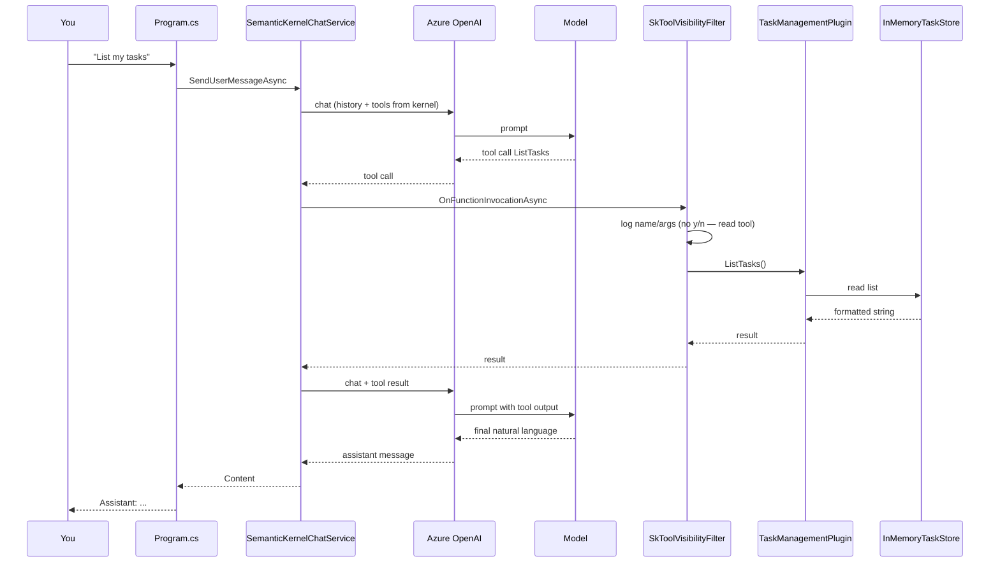

# Milestone 4 — Scenarios: What Happens in the Current Code

This document walks through **AIKnowledgeAssistant.SemanticKernel** (`Program.cs` → `SemanticKernelChatService`) with diagrams and plain-language discussion. The **manual** path is the sibling project **AIKnowledgeAssistant.Manual**. Both use **AIKnowledgeAssistant.Core** for the same task store and tool names.

---

## 1. Big picture — who does what



**Rule that never changes:** the model **never** opens your list or changes tasks. It only returns text and/or “please call function X.” **C#** runs inside `TaskManagementPlugin` → `InMemoryTaskStore`.

**K8s analogy:** the LLM is like a controller that emits “run Job ListTasks.” Semantic Kernel is the operator that sees that request, runs your Job (plugin method), and reports status back to the controller until the Job chain is done.

---

## 2. Code map (active path)

| Piece | File | Role |
| --- | --- | --- |
| Entry loop | `Program.cs` | Reads `You:`, calls `SendUserMessageAsync`, prints `Assistant:` |
| Orchestration | `Services/SemanticKernelChatService.cs` | Builds **Kernel**, Azure chat, plugin, `FunctionChoiceBehavior.Auto()` |
| Tools as C# | `Plugins/TaskManagementPlugin.cs` | `[KernelFunction]` methods → SK exposes them to the model |
| Data | `AIKnowledgeAssistant.Core` → `InMemoryTaskStore` | Shared with Manual app |
| Visibility + safety | `Services/SkToolVisibilityFilter.cs` | Logs each invocation; **y/n** for write tools |
| Write tool names | `Core` → `TaskToolNames` | Same names as Manual `LearningToolDefinitions` |

**Sibling project:** `AIKnowledgeAssistant.Manual` — hand-written tool loop; same Core store.

---

## 3. Startup — what gets built once

When you run `dotnet run`:

1. `Program.cs` loads `appsettings.json` → `AiSettings` (endpoint, deployment name, API key).
2. `SemanticKernelChatService` constructor:
   - Creates `InMemoryTaskStore` (seed tasks 1–3).
   - `Kernel.CreateBuilder()` + `AddAzureOpenAIChatCompletion(...)`.
   - Registers `SkToolVisibilityFilter` as `IFunctionInvocationFilter`.
   - `Plugins.AddFromObject(new TaskManagementPlugin(store), "TaskManagement")`.
   - Sets `FunctionChoiceBehavior.Auto()` so SK handles multi-turn tool loops internally.
3. `ChatHistory` gets the **system prompt** (tools list + “don’t lie if user denied write”).

You only type in the **while** loop after that.

---

## 4. One user message — internal loop (conceptual)

Your app calls **one** method:

```text
SendUserMessageAsync(userText)
  → AddUserMessage to ChatHistory
  → GetChatMessageContentAsync(history, Auto(), kernel)
```

Inside SK (simplified — may repeat until the model stops with text):

```text
  Round 1: HTTP → Azure → model may return tool call(s)
  Round 2: SK invokes filter → plugin → store → result back to model
  Round 3: … maybe another tool …
  Final:   model returns normal assistant text → returned to Program.cs
```

You do **not** write `if (FinishReason == ToolCalls)` anymore; SK does that when `kernel` + `Auto()` are passed in.



---

## 5. Scenario A — Read-only: “List tasks”

**You type:** `List tasks`

| Step | What happens |
| --- | --- |
| 1 | User message added to `ChatHistory`. |
| 2 | Model decides it needs `ListTasks` (no args). |
| 3 | **Filter** prints `--- SK auto function call ---`, function name, plugin `TaskManagement`, empty/minimal args. |
| 4 | `RequiresUserConfirmation("ListTasks")` → **false** → no prompt. |
| 5 | Filter calls `next` → **Plugin** `ListTasks()` → **Store** returns lines like `1. Fix login bug - Pending`. |
| 6 | Filter prints `Function result: ...`. |
| 7 | SK sends tool result to Azure; model summarizes for you. |
| 8 | `Program.cs` prints one `Assistant:` block. |

**Discuss:** This is the same *protocol* as Milestone 2, but the loop and tool metadata come from SK plugins instead of `ChatTool` + `LearningToolExecutor`.

---

## 6. Scenario B — Write approved: “Create task Review PR”

**You type:** `Create task Review PR`

| Step | What happens |
| --- | --- |
| 1 | Model requests `CreateTask` with `title` ≈ `"Review PR"`. |
| 2 | Filter logs function + `title = Review PR`. |
| 3 | `RequiresUserConfirmation("CreateTask")` → **true**. |
| 4 | Console: `*** WRITE tool ***` and `Approve and execute in C#? (y/n):`. |
| 5 | You type **y** → filter calls `next` → plugin `CreateTask(title)` → store adds task 4. |
| 6 | Tool result string e.g. `Created task 4: Review PR (Pending)` goes back to the model. |
| 7 | Assistant confirms in natural language. |

**Discuss:** The model **asked** to create a task; it did **not** create it until you approved and C# ran. System prompt + denied-message handling (Scenario C) keep the assistant honest.

---

## 7. Scenario C — Write denied: “Complete task 2” then **n**

**You type:** `Complete task 2`

| Step | What happens |
| --- | --- |
| 1 | Model requests `CompleteTask` with `id = 2`. |
| 2 | Filter prompts for approval. |
| 3 | You type **n** (or anything not y/yes). |
| 4 | Filter sets `context.Result` to `"User denied the operation. Data was not changed."` and **returns without** calling `next` → **plugin never runs**, store unchanged. |
| 5 | That denial string is what the model sees as the tool outcome. |
| 6 | Assistant should say completion did **not** happen (per system prompt). |

**Discuss:** Short-circuiting in the filter is the SK equivalent of Milestone 3 returning a fake tool result from the executor without calling the store.

---

## 8. Scenario D — Read-only with parameters: “I have 30 days total, used 12”

**You type:** something like `How many days left if total 30 and used 12?`

| Step | What happens |
| --- | --- |
| 1 | Model calls `CalculateRemainingDays(totalDays=30, usedDays=12)`. |
| 2 | Filter logs both arguments; no y/n. |
| 3 | Plugin returns `"18"` (string). |
| 4 | Model explains “18 days remaining.” |

**Discuss:** Parameter types come from C# method signatures; SK builds the schema for the model (contrast with hand-written JSON in `LearningToolDefinitions.cs`).

---

## 9. What you see in the console (order)

Typical pattern for a tool-using turn:

```text
You: List tasks

--- SK auto function call (model requested via FunctionChoiceBehavior.Auto) ---
Function: ListTasks
Plugin: TaskManagement
Arguments:
--- SK invoking C# plugin method now ---
Function result: 1. Fix login bug - Pending
...

Assistant: Here are your tasks: ...
```

Write turn adds the `*** WRITE tool ***` block **between** argument logging and `--- SK invoking C# ---` (or stops before invoke if you said no).

---

## 10. Manual vs Semantic Kernel (same app, two styles)

| Topic | Manual (M2/M3 files) | Semantic Kernel (M4, current) |
| --- | --- | --- |
| Tool definitions | `ChatTool.CreateFunctionTool` + JSON | `[KernelFunction]` + `[Description]` on methods |
| Execution | `LearningToolExecutor` switch | Plugin methods on `TaskManagementPlugin` |
| Loop | You: `while` + `FinishReason.ToolCalls` | SK: `GetChatMessageContentAsync` + `Auto()` |
| Logging / y/n | Inside executor | `SkToolVisibilityFilter` |
| Who talks to Azure | `ChatClient` directly | `IChatCompletionService` via kernel connector |

Keeping both in the repo lets you diff “protocol by hand” vs “protocol by framework.”

---

## 11. Common questions

**Does the model see my task list without a tool?**  
Only what you put in chat history and system prompt. Fresh task data for the model usually comes from a **tool result** after `ListTasks` (unless you pasted it yourself).

**Can the model skip the filter?**  
No. SK invokes plugin functions through the pipeline; your filter runs for auto-invoked kernel functions you registered this way.

**Why two endpoints in comments (resource URL vs `/openai/v1/`)?**  
OpenAI .NET SDK (M1–M3) uses a normalized chat base URL. SK’s Azure connector expects the **resource** root (`https://....openai.azure.com/`). `ToAzureResourceEndpoint` in `SemanticKernelChatService` handles that split.

**What’s next (M5+)?**  
Same kernel can gain **RAG** (documents → embeddings → search plugin) and longer **multi-step** flows without rewriting the manual loop again.

---

## 12. Try these prompts yourself

| Prompt | Expected tool | Notes |
| --- | --- | --- |
| `List tasks` | `ListTasks` | Read-only, immediate |
| `Create task Study Semantic Kernel` | `CreateTask` | Requires **y** |
| `Complete task 1` | `CompleteTask` | Requires **y**; try **n** once |
| `30 days total, 8 used — remaining?` | `CalculateRemainingDays` | Check logged args |

```powershell
dotnet run --project AIKnowledgeAssistant.SemanticKernel
```
