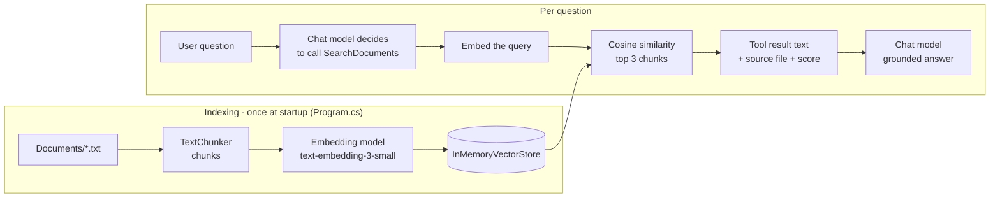

# Milestone 5 — Local Documents and RAG: steps and changes

What was added, **in the order it was done**, and why. Project: `AIKnowledgeAssistant.SemanticKernel`
(no new project: RAG reuses Semantic Kernel plugins and services, so it extends the Milestone 4 project;
the Milestone 4 state is preserved by the git tag `milestone-4-semantic-kernel`).

## The pipeline



## Step by step

| # | Step | What / why | Files |
| --- | --- | --- | --- |
| 1 | **Sample documents** | Three short text files. `leave-policy.txt` states 20 annual leave days (needed for Milestone 6). | `Documents/leave-policy.txt`, `company-rules.txt`, `technical-notes.txt` |
| 2 | **Chunk model** | A record holding the text and its source file name, so answers can cite the file. | `Rag/DocumentChunk.cs` |
| 3 | **Chunking** | Split on blank lines, merge small paragraphs up to ~500 characters. Smaller pieces give sharper vectors and less text sent to the model. | `Rag/TextChunker.cs` |
| 4 | **Vector store (hand-written)** | A list of (chunk, vector) pairs and `Search` using cosine similarity, `topK = 3`, `minScore = 0.3`. No database. | `Rag/InMemoryVectorStore.cs` |
| 5 | **Search service** | Index: file → chunks → embed → store. Search: embed the question → similarity search → formatted text. Returns `NOT_FOUND` if nothing is similar enough. | `Rag/DocumentSearchService.cs` |
| 6 | **Tool for the model** | `SearchDocuments(query)` as a read-only `[KernelFunction]`. The model decides when to call it, our C# runs it. | `Plugins/DocumentPlugin.cs` |
| 7 | **Config for the 2nd deployment** | `EmbeddingModel` setting (default `text-embedding-3-small`). Same Azure resource and key as the chat model. | `Core/Configuration/AiSettings.cs`, `appsettings.example.json`, local `appsettings.json` |
| 8 | **Register embeddings + plugin in the Kernel** | `AddAzureOpenAIEmbeddingGenerator(...)` (the current, non-obsolete SK API), then the `Documents` plugin. Added `IndexDocumentsAsync` because indexing calls Azure and is async. | `Services/SemanticKernelChatService.cs` |
| 9 | **Copy documents to the output folder** | So the app finds `Documents/` next to the exe. | `AIKnowledgeAssistant.SemanticKernel.csproj` |
| 10 | **Startup + system prompt** | Index at startup (prints chunk count). New prompt rules: call `SearchDocuments` first for policy questions, answer only from the result, say "not found" otherwise. | `Program.cs` |

No new NuGet packages: the existing `Microsoft.SemanticKernel` packages already contain the Azure embedding
connector and `Microsoft.Extensions.AI`.

## Concepts mapped to code

| Concept | Where |
| --- | --- |
| Chunking | `TextChunker.Chunk` |
| Embedding (text → vector, 1536 numbers) | `DocumentSearchService` → `GenerateVectorAsync` |
| Vector store | `InMemoryVectorStore` |
| Similarity search / semantic search | `InMemoryVectorStore.Search` + `CosineSimilarity` |
| RAG | the whole flow: retrieve first, then let the model answer from the retrieved text |
| Grounded answer | system prompt rule + tool result containing `[source: file]` |
| Hallucination guard | `NOT_FOUND` result + "never guess" rule in the system prompt |

## Execution order at runtime

1. `Program.cs` → `IndexDocumentsAsync` → each file chunked and embedded (Azure embedding call per chunk) → stored.
2. User asks a policy question.
3. SK sends the question and tool schemas (now including `SearchDocuments`) to the chat model.
4. Model replies: call `SearchDocuments(query)`. **The model does not read any file.**
5. `SkToolVisibilityFilter` logs the call (read-only, no y/n), then `DocumentPlugin` runs.
6. Query embedded → cosine similarity against all chunks → top matches returned as text.
7. SK sends that text back to the model → model writes the grounded answer, citing the file.

## How to run and test

```powershell
dotnet run --project AIKnowledgeAssistant.SemanticKernel
```

- `How many annual leave days do I get?` → answer from `leave-policy.txt`, with a `SearchDocuments` call logged.
- `What is the company dress code color?` → the assistant says it was not found in the documents.
- `Create task Review PR` → still asks y/n (write tools unchanged).

## Common errors

| Symptom | Cause / fix |
| --- | --- |
| 404 / `DeploymentNotFound` at startup | `EmbeddingModel` must be the exact **deployment name** in Azure, not just the model name. |
| 401 at startup | Wrong key, or the embedding deployment is in a different resource than `Endpoint`. |
| `DirectoryNotFoundException: Documents` | `Documents/` not copied; check the `csproj` `None Update` item and rebuild. |
| Wrong or no results | Tune `minScore` / `topK` in `InMemoryVectorStore.Search`. An unrelated question can still score ~0.3, so the model's "answer only from the text" rule is the second guard. |
| Changed a document but answers are old | Indexing happens at startup only; restart the app. |

## Known limits (on purpose, to stay simple)

- Vectors live in memory and are recomputed every start (costs a few embedding calls).
- Chunking is paragraph-based, with no overlap between chunks.
- Linear search over all chunks; fine for a few dozen chunks, not for thousands.
