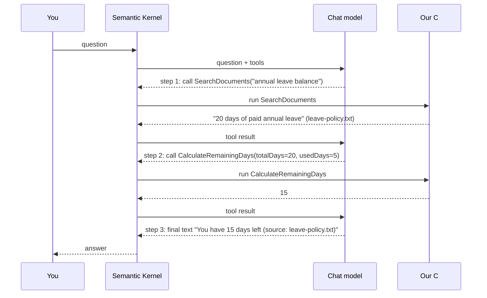

# Milestone 6: Agent behavior (multi-step)

## What was added

| What | File | Why |
| --- | --- | --- |
| New tool `CalculateRemainingDays` | `Plugins/CalculatorPlugin.cs` | gives the model a second step, and exact math done by C# |
| Registered the tool | `Services/SemanticKernelChatService.cs` | so the model knows it exists |
| System prompt: 3-step example | `Program.cs` | tells the model to search first, then calculate, then answer |
| Comment in the logger | `Services/FunctionCallLogger.cs` | the filter runs once per step, so the chain is visible |

No new loop code was needed. `FunctionChoiceBehavior.Auto()` already repeats
"model asks for a tool, we run it" until the model answers with plain text.

## The flow

Question: *"Read the leave policy and tell me how many days remain if I used 5 days."*

The console shows this as two `[tool call]` / `[tool result]` pairs, then `Assistant: ...`.

## Who decides what?

- **The model** decides the order of the steps and the arguments (`totalDays=20`).
  We only suggested the order in the system prompt. We did not hard-code it.
- **Our C# code** runs each tool. The model never runs anything.
- **Semantic Kernel** repeats the loop until the model stops asking for tools.

## Chat model, tool-using model, workflow, agent, agentic system

| Term | Meaning | In this project |
| --- | --- | --- |
| **Chat model** | Takes text, returns text. Cannot do anything else. | The model with no tools: it can only guess |
| **Tool-using model** | Can ask for a tool. We run it and return the result. | One question, one tool: "List tasks" |
| **Workflow** | Steps in a fixed order, written by a developer. | Not here. A workflow would be C# code like `Search(); Calculate();` |
| **Agent** | A model that chooses its own steps in a loop to reach a goal, and uses tool results to decide the next step. | The leave question: the model picks search, then calculate |
| **Agentic system** | A bigger system built around one or more agents: tools, memory, rules, limits, maybe several agents. | Not here. Possible examples: many agents, long-term memory, approval rules |

## Be accurate: is our demo a "fully autonomous agent"?

**No.** It is a small, simple agent-like behavior:

- The model chooses the order of 2 tools, so it is more than a fixed workflow.
- But the goal is tiny, the tools are 5 harmless methods, and the loop ends after one question.
- It has no long-term memory, no planning across questions, and no way to act without a user message.

Not every multi-step flow is an autonomous agent:

- A **fixed** multi-step flow (the developer writes step 1, step 2) is a **workflow**, even with several steps.
- A flow becomes **agent-like** when the **model** picks the next step from the results.
- **Fully autonomous** also needs the ability to pursue a goal with little or no human input.
  This demo does not have that.

## Honest limits to mention

- The model follows the 3-step example because the prompt says so. It can still skip a step, so the `[tool call]` lines are how you check.
- The model may call `CalculateRemainingDays` with a wrong number if `SearchDocuments` returned unclear text. Check the arguments in the log.
- Tools run without confirmation, so tools that change data (`CreateTask`) run as soon as the model asks.

## Try it

| Ask | Expected steps |
| --- | --- |
| `Read the leave policy and tell me how many days remain if I used 5 days.` | `SearchDocuments`, then `CalculateRemainingDays(totalDays=20, usedDays=5)`, answer: 15 |
| `How many annual leave days do I get?` | `SearchDocuments` only: 1 step |
| `Create task Review PR and then list tasks` | `CreateTask`, then `ListTasks` |
