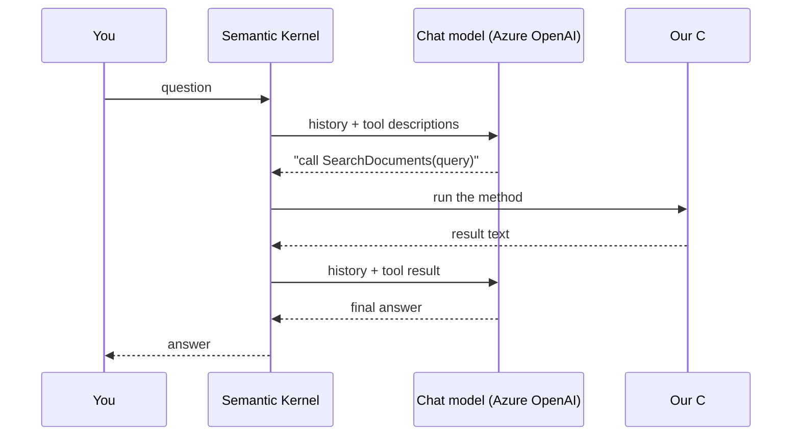
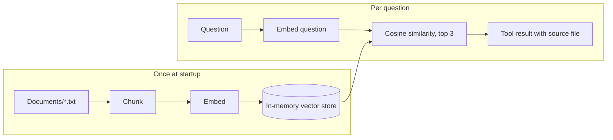

# Semantic Kernel + RAG demo

A small .NET 10 console app that shows two things:

1. **Semantic Kernel (SK)**: the model picks a C# method (a *tool*) and SK runs it.
2. **RAG**: the model answers questions from local text files instead of guessing.

## What the app can do

| You ask | What happens | Tool used |
| --- | --- | --- |
| "List tasks" | model asks for the tool, C# returns the tasks | `ListTasks` |
| "Create task Review PR" | model asks for the tool, C# adds the task (no confirmation) | `CreateTask` |
| "Complete task 1" | same idea | `CompleteTask` |
| "How many annual leave days do I get?" | model searches the documents, then answers from the result | `SearchDocuments` (RAG) |

Tasks are a fake in-memory list. Documents are the `.txt` files in `Documents/`.
For every tool call the console prints `[tool call]` and `[tool result]` before the final answer.

## Key idea: the model asks, our code executes



`FunctionChoiceBehavior.Auto()` makes SK run this loop automatically.

## RAG pipeline



| Step | Code |
| --- | --- |
| Chunking (split on blank lines, ~500 chars) | `Rag/TextChunker.cs` |
| Embedding (text to 1536 numbers) | `Rag/DocumentSearchService.cs` |
| Vector store and cosine similarity | `Rag/InMemoryVectorStore.cs` |
| Tool the model can call | `Plugins/DocumentPlugin.cs` |
| "Not found" guard against guessing | `NOT_FOUND` result plus the system prompt in `Program.cs` |

## Project layout (one project)

```
AIKnowledgeAssistant.SemanticKernel/
  Program.cs                      system prompt, settings, indexing, chat loop
  Services/SemanticKernelChatService.cs   all SK wiring: kernel, plugins, filter, history
  Services/FunctionCallLogger.cs          prints each tool call and result
  Plugins/TaskManagementPlugin.cs         task tools
  Plugins/DocumentPlugin.cs               SearchDocuments tool (RAG)
  Rag/                                    chunker, vector store, search service
  Data/, Models/                          fake task store
  Documents/                              sample documents (leave policy, rules, notes)
```

For a walk through the code, see [CODE-EXPLAINED.md](./CODE-EXPLAINED.md).

## Setup

1. Install the [.NET 10 SDK](https://dotnet.microsoft.com/download).
2. Copy `AIKnowledgeAssistant.SemanticKernel/appsettings.example.json` to `appsettings.json` in the same folder.
3. Set `Endpoint`, `ApiKey`, `Model` (chat deployment name) and `EmbeddingModel` (embedding deployment name).
4. Run:

```powershell
dotnet run --project AIKnowledgeAssistant.SemanticKernel
```

`appsettings.json` is gitignored, so the key is never committed.
